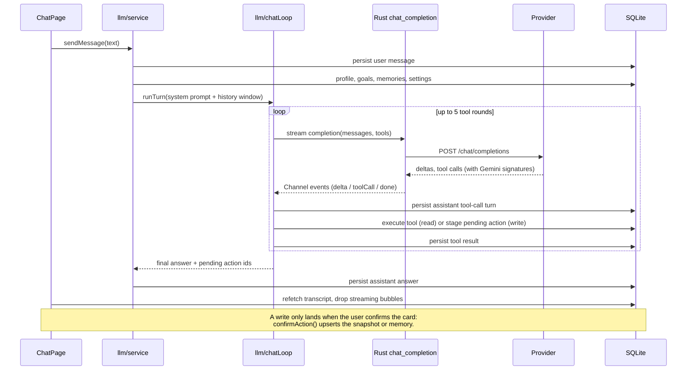

# Architecture

FinanceTracker is a native macOS desktop app: single user, offline-first, Tauri v2, and your data stays on your Mac.

## Principle: thin Rust

The UI and all business logic are TypeScript. Rust does only what a webview cannot or should not do:

| Concern | Where | Why |
|---|---|---|
| UI, routing, forms, validation | `src/ui` (React 19, react-bootstrap) | Bootstrap classes are shared with `custom.css` |
| Business logic, money math, formatting | `src/domain` (pure TypeScript) | Pure functions, unit-tested, no I/O |
| SQL | `src/db/repositories` | One file per aggregate, typed SQL only, no business logic |
| Atomic multi-statement writes | Rust `run_transaction` | One transaction on one guarded connection (see below) |
| Provider API keys | Rust `secret_*` (macOS Keychain) | Keys never enter SQLite |
| LLM HTTP and streaming | Rust `chat_completion` (reqwest) | Streams over a Tauri channel; cancellable |
| User-picked file read/write | Rust `pick_and_read_text_file`, `save_text_file` | The webview never supplies a path; Rust opens the dialog |

## Layers

```
src/ui/pages/*        screens (one folder per area)
src/ui/components/*   shared widgets (FormCard, DataTable, modals, StatCard)
src/ui/layout/*       AppShell, sidebar, toolbar, toasts, theme toggle
        |
        v  (TanStack Query for reads and invalidation)
src/db/repositories/* typed SQL -> db_select (read-only) / execute_write / run_transaction
        |
src/domain/*          pure logic imported by both pages and repositories
src/llm/*             chat loop, tools, pending actions (TypeScript)
src/import/*          backup importer: parse -> plan -> SQL statements
src-tauri/src/commands/{db,files,llm,lock,secrets}.rs
```

The lock is the one thing above the router: `App.tsx` nests
`SeedGate → LockGate → RouterProvider`, so while the gate is up no route is
mounted and the shell does not exist (`src/ui/layout/LockGate.tsx`).

## Shell

The window is a desktop app, not a page: a collapsible sidebar holds the
navigation, a 52 px toolbar carries the account menu and acts as the drag region
for the overlay title bar (the traffic lights sit over the sidebar's top strip),
and only the content area scrolls. `html`, `body` and `#root` are pinned to 100%
in `custom.css`; `.app-content` is a flex column so a page can fill the window
(the chat does) while everything else keeps its natural height. Toasts are a
fixed stack under the toolbar, outside the page flow.

Rules the code follows:
- `domain` imports nothing from `ui` or `db`. It is what the tests and the oracles exercise.
- Pages never write SQL. Repositories never format or validate.
- Reads go through TanStack Query; every write invalidates the affected query keys (`snapshot-rows`, `assets`, `snapshot-points`, ...).
- Filters, sort and page live in the URL query (hash router).

## Data model

SQLite at `~/Library/Application Support/app.financetracker/financetracker.db`, created by migrations in `src-tauri/migrations/` (applied by `sqlx::migrate!` from `Builder::setup`, before the window exists). Schema notes:

- **Money is `INTEGER` minor units** (`amount_minor`). Conversion happens at the edge in `src/domain/money.ts`, half-even rounding, `decimal.js`. No float money anywhere.
- **Exchange rates are `TEXT` decimals.**
- **No `user_id`.** One user; per-user uniques became global.
- **Secrets are never columns.** `llm_providers.keychain_ref` is a reference such as `provider:2`; the secret is in the Keychain.
- **Profile is a single-row table.** The former user profile fields live there.
- **`ChatJob` is gone**, replaced by a Tauri channel.
- Calendar dates are `YYYY-MM-DD` text with CHECK constraints; one snapshot per `(asset_id, date)` is enforced by a unique index.
- Foreign keys are on; `journal_mode=WAL` is set once per database file (`src/db/client.ts`).

## Transactions

The webview holds no database handle: the SQL plugin is not installed, so every
statement crosses the IPC boundary as text. Rust
enforces three boundaries on that text — `db_select` runs on a read-only
connection with a read-only authorizer, `execute_write` admits only single
`INSERT`/`UPDATE`/`DELETE` statements, and `run_transaction` runs a list
atomically. Multi-statement writes go through `run_transaction`:

1. Build a statement list in TypeScript, with every value passed through the escaped literal builders in `src/db/literals.ts` (`sqlText`, `sqlInt`, ...).
2. `run_transaction` (`src-tauri/src/commands/db.rs`) opens its own connection to the same file with foreign keys on and a 5 s busy timeout, runs the list in one transaction, and rolls back on the first failure, reporting `statement N of M`.

Used by: the backup importer (196 statements, atomic), asset create/update (asset + tags + first snapshot), bulk snapshot create/update/delete.

New asset ids are allocated inside the transaction (`nextId` / `justInserted` against `sqlite_sequence` in `src/db/transaction.ts`), so later statements can reference the id without a round trip.

## Money

- Amounts are `INTEGER` minor units in SQLite; conversion happens at the edge in
  `src/domain/money.ts`, half-even, with `decimal.js`. No float money anywhere.
- All displayed numbers go through `src/domain/format.ts`.

## The chat turn, end to end

Rendered by GitHub; the same flow in prose is under "Layers".



## Tests

Four layers, cheapest first:

| Layer | Where | What it proves |
|---|---|---|
| Unit | `src/domain/*.test.ts`, `src/llm/*.test.ts` | Pure logic: money, filters, dashboards, prompt text, the loop with an injected transport |
| Component | `src/ui/**/*.test.tsx` (jsdom) | Screens with repositories mocked: filters, validation, confirm cards |
| Rust | `src-tauri/tests/*.rs`, module tests | One transaction or none, the statement guard, migrations, stream parsing and cancellation |
| Live | `cargo test --test live`, `GEMINI_API_KEY` | A real provider, opt-in |

The live tests are opt-in so the default suite needs no network.
`src/docs.test.ts` keeps the version in three files in step and fails on a broken
relative link.

## Build and layout

```
src/              React app
src-tauri/        Rust: commands, migrations, capabilities, tests
tests/            Python round-trip check and fixtures
docs/             release notes, import format, troubleshooting, changelog
```

Stack: Tauri 2, React 19, TypeScript, Vite, react-router (hash), TanStack Query, react-hook-form + zod, react-bootstrap, Chart.js, decimal.js, SQLite via `sqlx` (Rust only) and `keyring`.
