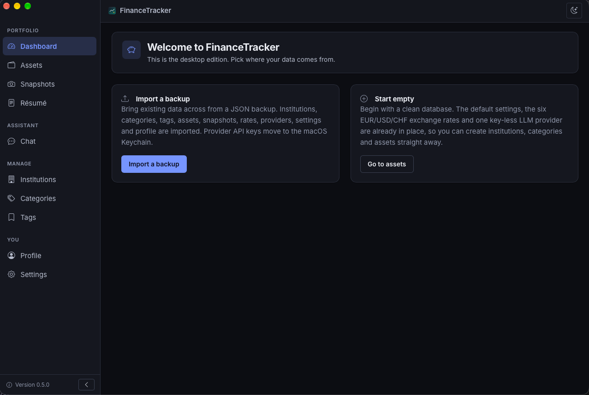

# FinanceTracker (desktop)

A native macOS app for tracking assets and their value over time. Single user, offline, data stays on your Mac.

Version 0.6.1 · MIT · macOS 11+ (Apple silicon)



> **Alpha.** The app is under active development: features move, bugs are
> expected, and a bad import can leave your data in a state you did not want.
> Take a backup (Settings → Data & Backup) before trusting it with anything that
> matters, and keep a copy of the JSON export somewhere else.

Stack: Tauri 2, React 19 + TypeScript + Vite, SQLite, Rust only for Keychain, LLM HTTP and file/transaction primitives.

Contents: [Install](#install) · [Demo build](#demo-build) · [Requirements](#requirements) · [Run](#run) · [Build](#build) · [Test](#test) · [AI](#ai) · [Your data](#your-data) · [Troubleshooting](#troubleshooting) · [Documentation](#documentation) · [License](#license)

## Install

Download the latest `.dmg` from
[Releases](https://github.com/juliendf/FinanceTrackerApp/releases), open it and
drag the app to Applications.

The build is signed ad hoc and not notarised (no Apple Developer ID yet), so
macOS blocks the first launch with *"Apple could not verify that FinanceTracker
is free of malware"*. Open **System Settings → Privacy & Security**, scroll down
and click **Open Anyway**; on macOS 14 and older, right-clicking the app → **Open**
does the same thing. macOS remembers the choice afterwards.

The terminal equivalent, if you prefer it, is one line. It does exactly what
**Open Anyway** does — it is not a different mechanism, and it only makes sense
for a copy you downloaded from this release page, since it skips the check
instead of passing it:

```sh
xattr -dr com.apple.quarantine /Applications/FinanceTracker.app
```

Updates are signed separately and verified with the app's own key — **Check for
updates** in Settings → General.

## Demo build

A second app with its own bundle identifier, its own data directory and sample
data, so a demo never touches your real numbers:

```sh
npm run demo:build      # bundle only
npm run demo:local      # build and open it
npm run demo:install    # build and replace /Applications/FinanceTracker Demo.app
```

It installs as **FinanceTracker Demo** beside the normal app and stores its
database in `~/Library/Application Support/app.financetracker.demo/`.
Load **Settings → Data & Backups → Sample data** to fill it. The LLM provider
keys are shared with the normal app on purpose; the financial data is not.

Every release also carries the demo DMG, its signed update archive and its own
manifest (`latest-demo.json`), so the demo updates itself from **Check for
updates** like the normal app.

## Requirements

- macOS 11 or newer, Apple silicon
- Node 20.19+ or 22.12+ (Vite 8's requirement) and npm
- Rust stable via `rustup`, with `cargo` on your `PATH`
- Xcode command line tools

If `which cargo` prints nothing, rustup's environment file is not sourced:

```sh
echo '. "$HOME/.cargo/env"' >> ~/.zshrc   # then open a new terminal
```

## Run

```sh
npm install
npm run tauri dev        # app with hot reload
```

`tauri dev` is the way to try a change without building or installing anything: it
compiles a debug binary once, serves the UI from Vite and reloads the frontend on
save. Rust changes restart the app.

Two things to know:

- **It uses the same database as the installed app** (same bundle identifier,
  same `~/Library/Application Support/app.financetracker/`). Testing
  writes to your real data; take a backup from Settings → Data & Backup first if
  that matters.
- **Running the UI alone with `npm run dev` in a browser only works for static
  screens.** SQLite, dialogs, the Keychain and the updater are Tauri commands and
  are absent outside the webview.

## Build

```sh
npm run app:local        # ad-hoc build, then open the app
npm run app:install      # ad-hoc build and replace /Applications/FinanceTracker.app
npm run app:build        # just the bundle, no signing key needed
npm run tauri build      # the default bundle
# src-tauri/target/release/bundle/macos/FinanceTracker.app
# src-tauri/target/release/bundle/dmg/FinanceTracker_<version>_aarch64.dmg
```

Iterating does not need a release: `npm run tauri dev` for the UI,
`npm run app:local` when you want a real bundle with the dock icon and the
updater card. A tag is only for distributing a version.

The build is ad-hoc signed (no Apple Developer ID yet), so the first launch is
blocked by Gatekeeper until you allow it in System Settings → Privacy & Security.
Signing, notarisation, the updater keys and the GitHub Actions release are
documented in [docs/RELEASE.md](docs/RELEASE.md).

## Test

```sh
npm test            # vitest: domain, repositories, components, docs guards
npm run typecheck   # app and tests
cd src-tauri && cargo test
```

Rust tests cover the transaction primitive, the statement guard, migrations and
the keychain move; the ones needing the network, a live provider or the login
keychain are `#[ignore]`d (`cargo test -- --ignored`).

The backup round-trip can be re-checked on real data: export the database, import it into a fresh one, diff the rows.

```sh
python3 tests/roundtrip/compare.py ORIGINAL.db REBUILT.db
```

## AI

Chat is off until you enable it under Settings → LLM Providers. For a local model:

1. Settings → LLM Providers → New Provider: base URL `http://localhost:11434/v1`, no key. Press **Load models**, then enable the ones chat may use (a tool-capable one, e.g. `qwen3.5:4b`) and pick the default.
2. Tick **Enable AI features** on the same page (it sits above the provider list).
3. Chat. Write actions (recording a snapshot, saving a memory) always appear as a card you confirm or reject. The same page has *Stream answers as they arrive*; turn it off to get a spinner (which names the tool it is running) and the whole reply at once.

Keys live in the macOS Keychain, never in the database or a backup.

## Your data

- Database: `~/Library/Application Support/app.financetracker/financetracker.db`
- Provider API keys: macOS Keychain, service `app.financetracker`
- Import a legacy JSON backup (v2) from the first-run screen or Settings → Data & Backup; format in [docs/IMPORT_FORMAT.md](docs/IMPORT_FORMAT.md). Never commit a real backup.

## Troubleshooting

The common failures and their fixes are in
[docs/TROUBLESHOOTING.md](docs/TROUBLESHOOTING.md): `cargo` not found, port 1420
in use, Gatekeeper on an ad-hoc build, "no update feed", Gemini 400s, a model
that will not call tools, where the database lives, and what to do when a page
shows the error boundary.

## Documentation

| Document | Purpose |
|---|---|
| [ARCHITECTURE.md](ARCHITECTURE.md) | Layers, data model, transactions |
| [SECURITY.md](SECURITY.md) | Threat model, secrets, open issues |
| [docs/MAINTAINING.md](docs/MAINTAINING.md) | How releases, versioning and data safety work |
| [AGENTS.md](AGENTS.md) | Short brief for agents and new maintainers |
| [docs/RELEASE.md](docs/RELEASE.md) | Signing, notarisation, updater, releases |
| [docs/IMPORT_FORMAT.md](docs/IMPORT_FORMAT.md) | Backup file format |
| [CONTRIBUTING.md](CONTRIBUTING.md) | Layout, conventions, how to add a screen, tool or migration |
| [docs/TROUBLESHOOTING.md](docs/TROUBLESHOOTING.md) | Symptoms, causes, fixes |
| [docs/CHANGELOG.md](docs/CHANGELOG.md) | Release-by-release summary |

## License

MIT — see [LICENSE](LICENSE).
